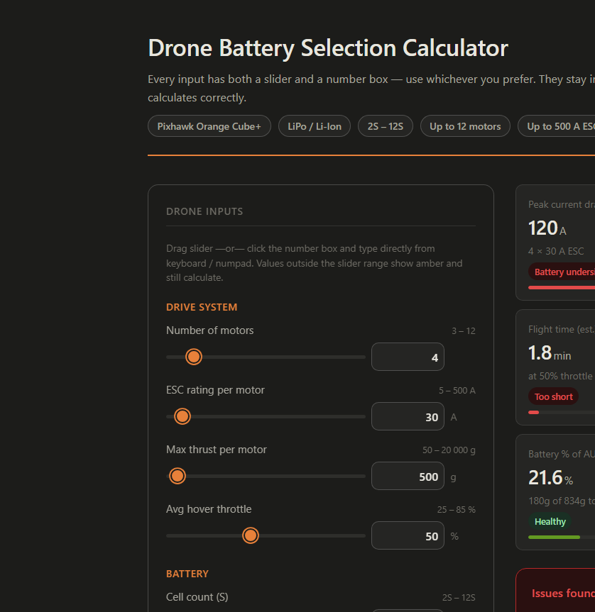
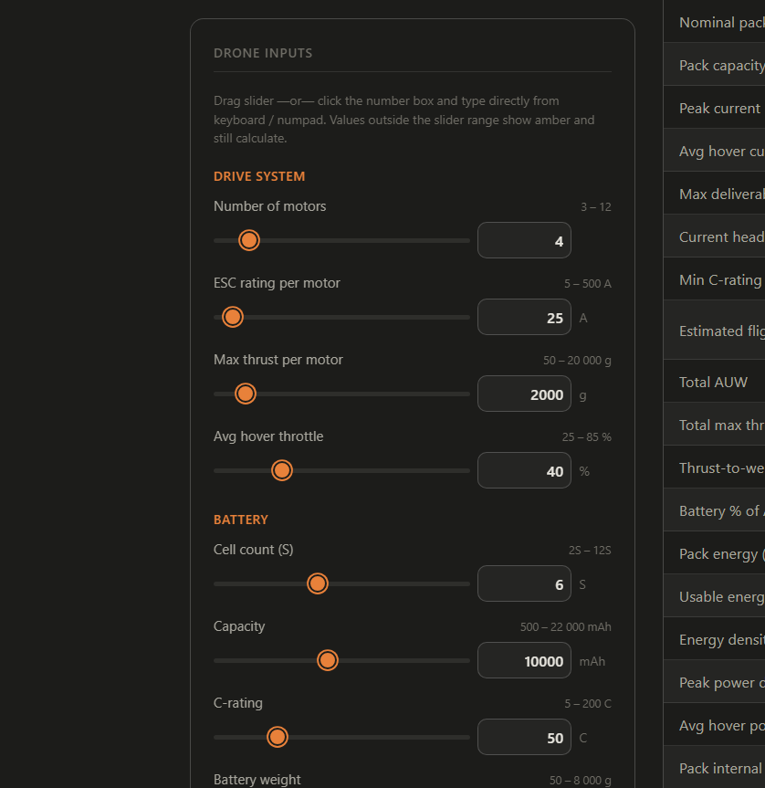
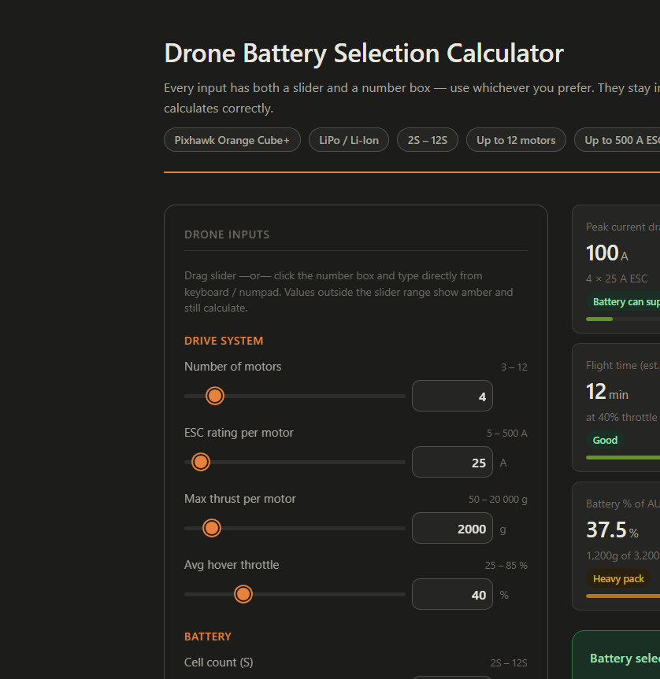

# Drone Battery Calculator

A lightweight, browser-based tool for sizing and validating drone batteries before flight. The calculator combines practical engineering checks with a clean UI so you can quickly estimate whether a proposed LiPo or Li-Ion pack is suitable for a multirotor build.

It is designed for drone builders, hobbyists, and educators who want a fast sanity check on motor/ESC load, pack capacity, C-rating, thrust-to-weight ratio, flight time, and voltage sag without needing a full spreadsheet or external simulation suite.

## Why this project exists

Choosing a battery for a drone is not just about capacity. A pack can look large on paper but still fail because:

- the battery cannot supply the required peak current
- C-rating is too low for the load
- the drone's thrust-to-weight ratio is not safe
- flight time is too short for the mission
- the pack is too heavy and hurts performance
- voltage sag under load is excessive

This project helps answer those questions in a single place.

## What the calculator evaluates

The app calculates and summarizes the most important battery selection checks:

- peak current draw from motors and ESC ratings
- minimum C-rating required with safety margin
- available current headroom
- estimated flight time at hover throttle
- thrust-to-weight ratio using total aircraft weight
- battery percentage of AUW
- energy and pack density
- voltage sag under hover load
- an overall pass/fail verdict with a detailed breakdown

The default inputs are tuned for common multirotor designs and the UI supports both slider-based adjustments and direct numeric entry.

## Demo / screenshots

### Overview



### Detailed breakdown



### Pass-state example



## Features

- interactive slider + numeric input syncing
- range-aware values with validation feedback
- real-time recalculation as inputs change
- pass/fail verdict with explanation
- formula breakdown for transparency
- static front-end app with no build pipeline required
- ready for GitHub Pages or local preview

## Project structure

```text
.
├── .github/
│   └── workflows/
│       └── quality.yml
├── docs/
│   └── images/
├── src/
│   ├── config.js
│   ├── phase1/
│   │   └── calculator.js
│   └── phase2/
│       ├── styles.css
│       └── ui.js
├── tests/
│   ├── calculator.test.js
│   └── repository_structure.test.js
├── .gitignore
├── LICENSE
├── README.md
├── bat_cal.html
├── index.html
├── package.json
├── requirements.txt
└── ...
```

## Local usage

### Option 1: open directly in the browser

Open `index.html` in a web browser.

### Option 2: run a local static server

Python is included with most development machines and works well for this project:

```bash
python -m http.server 4173
```

Then open:

```text
http://localhost:4173
```

### Automated checks

This project includes Node.js-based validation checks. If you want to run them locally:

```bash
npm test
```

Requirements:

- Node.js 18+
- npm

## Notes on engineering assumptions

This is a practical calculator, not a full flight dynamics simulator. It uses simplified assumptions such as:

- 80% usable battery capacity
- 20% safety margin for minimum C-rating
- hover current model for estimating voltage sag and flight time
- static estimates based on nominal electrical behavior

These assumptions are useful for quick design screening, but the final choice should still be validated with bench testing and field trial data.

## License

This project is licensed under the MIT License. See [LICENSE](LICENSE) for details.

## Contribution

Contributions are welcome. Suggestions for improved formulas, better UI behavior, or additional validation checks are encouraged.

---

This project is intended to make battery sizing feel less like guesswork and more like a clear engineering decision.
